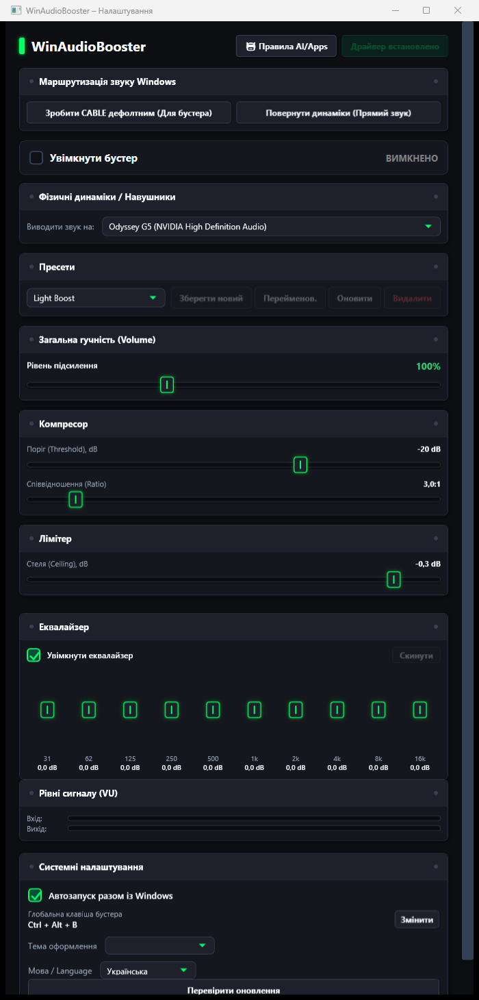

# WinAudioBooster

<div align="center">

[](https://github.com/Xydik1otto/WinAudioBooster/actions/workflows/build.yml)
[](https://github.com/Xydik1otto/WinAudioBooster/actions/workflows/release.yml)
[](https://github.com/Xydik1otto/WinAudioBooster/releases)
[](LICENSE)
[](https://dotnet.microsoft.com/download/dotnet/8.0)

</div>

<p align="center">
  
</p>

**WinAudioBooster** is a Windows application that boosts system volume up to **300%** and adds professional DSP processing: a 10-band equalizer, compressor, and soft limiter. The application works through a VB-Audio CABLE virtual audio device: all Windows audio is redirected to the virtual device, captured via WASAPI loopback, processed, and played back on the physical speakers.

## Features

- **Volume booster up to 300%** — gain above 100% is implemented as software DSP gain, not through the standard Windows mixer.
- **10-band equalizer** — fine-grained tone control in real time.
- **Compressor** — threshold, ratio, attack, and release for leveling dynamics.
- **Soft limiter** — a ceiling in dB that protects against overload and clipping.
- **Presets** — built-in (Light Boost, Max Boost, Headphones, Games, Calls, **Night Mode**) and custom, saved to a file.
- **Loudness normalization** — automatic level alignment (RMS AGC): quiet sources are raised, loud ones do not clip.
- **Stereo widening** — widening of the stereo image (M/S processing).
- **Crossfeed** — a "speakers through headphones" effect that reduces fatigue during long listening sessions.
- **Balance / Mono** — L/R balance control and mono switching (useful for single-channel headphones).
- **Spectrum visualizer** — live spectrum with peak history in the main window.
- **Bass Boost / Treble Boost** — one-click toggles on top of the equalizer.
- **Per-app mixer** — individual volume rules for separate processes, persisted between sessions.
- **Device auto-profiles** — "output device to preset" bindings: connecting headphones activates the profile automatically.
- **Mini window** — compact mode with the main controls.
- **System tray** — control from the notification area, minimize to tray.
- **Hotkeys** — `Ctrl + Alt + B` booster, `Ctrl + Alt + 1..5` presets, `Ctrl + Alt + D` DSP bypass.
- **Sleep timer** — mutes audio after 15/30/60 minutes with a smooth fade-out.
- **Auto theme** — the "Auto (Windows)" mode follows the system dark/light theme.
- **Hearing protection** — a warning when boosting above 150%.
- **Autostart** — starts with Windows.
- **4 themes** — Win11 Fluent, Arch Linux, Windows XP, StudioRack (+ light overlay).
- **UA / EN localization** — Ukrainian and English interface languages.
- **Automatic output switching** — Windows switches to VB-Cable when the booster starts and back to the physical device when it stops.
- **One-click auto-update** — download and install a new exe directly from the application (SHA256 verification, `.bak` backup, automatic restart).
- **File logging** — diagnostics are written to `%APPDATA%\WinAudioBooster\log.txt`.

## Requirements

- **Windows 10 / 11 (x64)**.
- [.NET 8 Desktop Runtime](https://dotnet.microsoft.com/download/dotnet/8.0) — **not required** for the GitHub Releases build (single-file, self-contained).
- **VB-Audio CABLE** (virtual audio cable) — **the application offers to install it on first launch**; the installer is built in (`Services/VbCableInstaller.cs`), and the driver archive can sit next to the exe or be downloaded automatically.

## Installation

### Option 1 — prebuilt binary (recommended)

1. Open the [Releases](https://github.com/Xydik1otto/WinAudioBooster/releases) page.
2. Download `WinAudioBooster.exe` from the latest release.
3. Run the exe — no installation is required; the file is self-contained.
4. On first launch, accept the installation of **VB-Audio CABLE** if it is not found on the system.
5. **Auto-update**: the application checks for updates through GitHub Releases on its own. When a new version is available, it can be downloaded and installed directly from the application — it downloads the new `WinAudioBooster.exe`, verifies its SHA256, saves the old file as `WinAudioBooster.exe.bak`, replaces it, and restarts after the current process exits.

### Option 2 — build from source

Requires the .NET 8 SDK:

```bash
git clone https://github.com/Xydik1otto/WinAudioBooster.git
cd WinAudioBooster
dotnet publish WinAudioBooster/WinAudioBooster.csproj -c Release -r win-x64 --self-contained true -p:PublishSingleFile=true
```

The resulting exe: `WinAudioBooster/bin/Release/net8.0-windows/win-x64/publish/WinAudioBooster.exe`.

## Usage

1. Run `WinAudioBooster.exe`.
2. If VB-Cable is not installed, accept the installation and restart the system if needed.
3. Enable the **booster** with the main switch — the application switches the system output to VB-Cable and starts processing.
4. Adjust **Gain** (up to 300%), the **EQ** bands, the compressor, and the limiter — or pick a ready-made **preset**.
5. For quiet background operation, minimize the window to the **tray**; the mini window is available from the main interface.
6. The `Ctrl + Alt + B` hotkey (default) quickly toggles the booster on and off.

Stopping the booster returns the system output to the previous physical device.

## How it works

In short: all Windows applications output audio to the virtual **VB-Cable** device (temporarily assigned as the system default output). The application captures this stream via **WASAPI loopback** (`WasapiLoopbackCapture`), buffers it (`BufferedWaveProvider`), applies the DSP chain — gain → 10-band EQ → boost shelves → stereo widening → crossfeed → balance/mono → compressor → loudness AGC → soft limiter — and plays the result on the physical speakers through `WasapiOut` (with `MediaFoundationResampler` resampling to the output device format when needed).

A detailed description of the architecture and data-flow diagrams is in [docs/ARCHITECTURE.md](docs/ARCHITECTURE.md).

## Troubleshooting

| Problem | Solution |
|---|---|
| **No sound after enabling the booster** | Check that the booster is running (indicator in the window/tray). Make sure the correct physical output device is selected in settings. Try restarting the booster — device switching sometimes requires WASAPI re-initialization. |
| **"Cable not found" / VB-Cable missing from the device list** | Install VB-Audio CABLE through the dialog offered by the application or manually from [vb-audio.com](https://vb-audio.com/Cable/). After installation, **restart Windows**. Make sure the "CABLE Input" device appears in Windows sound settings. |
| **Sound stutters or drops out** | Increase the buffer: the application uses a 2-second buffer with discard on overflow — check CPU load and close heavy applications. |
| **Sound is distorted at maximum volume** | Reduce Gain or enable the limiter/compressor — the limiter's default ceiling of -0.3 dB protects against clipping. |
| **Hotkeys do not work** | The combination may be taken by another application — change the hotkey in settings. |
| **The application does not start** | The Releases build is self-contained (.NET is bundled). If you built from source, make sure the .NET 8 Desktop Runtime is installed. |

## Settings location

`appsettings.json` (settings) and `presets.json` (custom presets) are stored in **`%APPDATA%\WinAudioBooster\`**. If the files still sit next to the executable (an older version of the application), they are migrated automatically on first launch.

## FAQ

**Why is VB-Audio CABLE needed?**
Windows does not allow capturing system audio directly while simultaneously playing processed audio back on the same speakers. VB-Cable is a virtual loop: all applications play into it, and WinAudioBooster captures that stream via WASAPI loopback, processes it, and outputs it to the real device. The application offers to install it on first launch.

**Why is audio delayed or missing after enabling the booster?**
The virtual cable plus buffering adds a small delay (about 250 ms) — barely noticeable for browser video, but perceptible in games. If there is no sound at all, check that the booster is running, that the correct physical output device is selected in settings, and that "CABLE Input" appears in the Windows device list; restarting the booster helps.

**How do I reset settings?**
Delete the `%APPDATA%\WinAudioBooster\` folder — on the next launch the application recreates everything from defaults (custom presets are deleted as well).

**Where is the log?**
Log file: `%APPDATA%\WinAudioBooster\log.txt`. Attach it to an issue if something does not work — but first remove any personal paths it may contain.

## License

The project is distributed under the [MIT](LICENSE) license.
